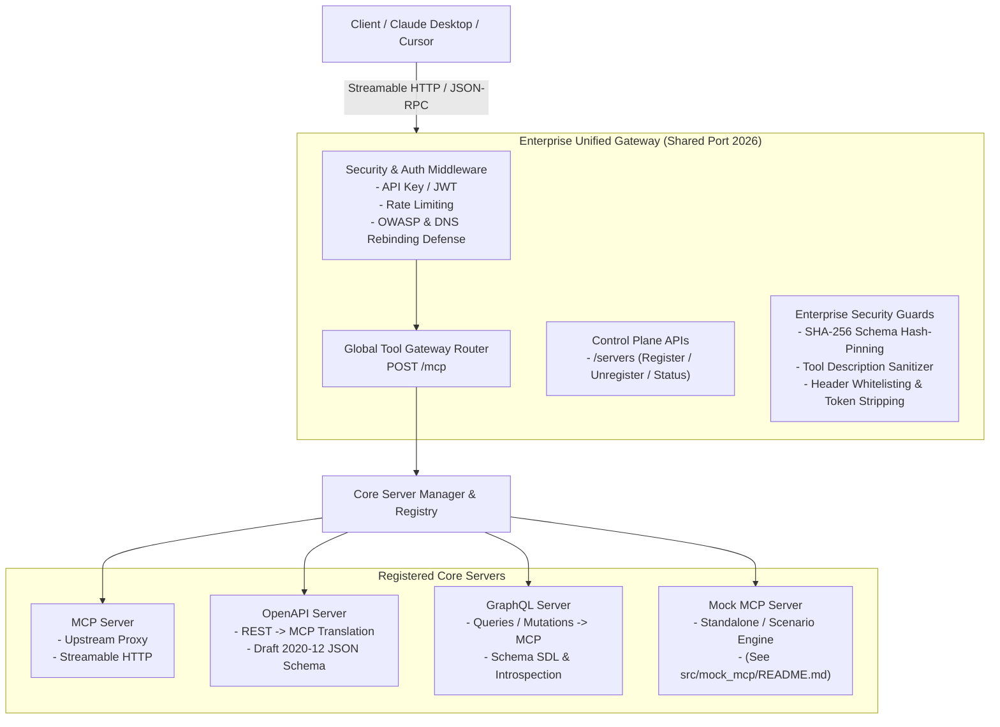

# Enterprise MCP Gateway

Hệ thống **Enterprise Unified MCP Gateway** phát triển trên **Python 3.14**, hỗ trợ **Đăng ký động (Dynamic Registration) các MCP Server, OpenAPI Server, và GraphQL Server**, **Global Tool Gateway Router (`POST /mcp`)**, compliant với **MCP Specification (2026-07-28)** và **JSON Schema Draft 2020-12**.

---

## 🏛️ Sơ Đồ Kiến Trúc Hệ Thống (Architecture Diagram)



---

## 🐍 Yêu Cầu Môi Trường & Runtime

- **Python Version**: `3.14` (Cấu hình qua `.python-version`, `pyproject.toml`, `Dockerfile`, và `uv.lock`).
- **Package Manager**: `uv` (Fast Python package installer).
- **Core Frameworks**: `starlette`, `pydantic>=2.10.0`, `loguru>=0.7.3`, `pyjwt>=2.10.0`, `httpx>=0.28.0`.

---

## 🌐 Dynamic Server Control Plane (`/servers`)

Tất cả các server bên ngoài (**MCP Server**, **OpenAPI Server**, **GraphQL Server**) được quản lý tập trung và đồng nhất qua **DUY NHẤT 1 Endpoint Resource (`/servers`)**:

1. **Server Lifecycle & Management APIs**:
   - `POST /servers/register`: Đăng ký động một **MCP Server**, **OpenAPI Server**, hoặc **GraphQL Server**.
   - `GET /servers`: Liệt kê tất cả các Server đã đăng ký.
   - `GET /servers/{server_id}`: Lấy thông tin cấu hình chi tiết của một Server.
   - `GET /servers/{server_id}/status`: Kiểm tra trạng thái vận hành (`Running`, `Paused`, `Stopped`, `Failed`).
   - `GET /servers/{server_id}/logs`: Xem nhật ký runtime loguru của Server.
   - `GET /servers/{server_id}/tools`: Danh sách các MCP Tools phát hiện được từ Server.
   - `PUT /servers/{server_id}`: Cập nhật cấu hình hoặc Tạm dừng / Kích hoạt lại Server.
   - `DELETE /servers/{server_id}`: Hủy đăng ký / gỡ Server khỏi Gateway.

2. **Bảo vệ An Ninh Enterprise (Security Guards)**:
   - **SHA-256 Schema Hash-Pinning Guard**: Phòng chống tấn công Rug-Pull sửa đổi schema động.
   - **Tool Description Sanitizer**: Loại bỏ mã độc/prompt injection trong mô tả công cụ.
   - **Header Forwarding Whitelist & Token Stripping**: Tự động loại bỏ `Authorization: Bearer` của client trước khi chuyển tiếp downstream, đồng thời hỗ trợ `allowed_forward_headers` whitelist và truyền minh bạch các header chuẩn (`X-Request-ID`, `traceparent`, `X-Session-ID`, `X-MCP-Scenario`).

---

## 🌐 Global Tool Gateway Router (`POST /mcp`)

Endpoint tập trung **`POST /mcp`** hoạt động trên một cổng duy nhất (`2026`) theo chuẩn MCP 2026-07-28 Spec:
- **Tự động hợp nhất (Aggregate)** danh mục công cụ từ tất cả các Server đang chạy (`Running`).
- **Tự động điều tuyến (Dynamic Routing)** các cuộc gọi `tools/call` tới đúng **MCP Server**, **OpenAPI Server**, hoặc **GraphQL Server**.
- **Thi hành An ninh**: Áp dụng Authentication (API Key / JWT), Sliding-Window Rate Limiting, và Header Whitelisting.

---

## 🔌 Hỗ Trợ Loại Server (MCP, OpenAPI, GraphQL)

Hệ thống tự động hỗ trợ 3 loại Server cốt lõi:
- **MCP Server**: Kết nối tới các MCP Server nguyên bản qua Streamable HTTP/JSON-RPC.
- **OpenAPI Server**: Phân tích cú pháp OpenAPI Spec (v3.x) từ URL/local path, dereference `$ref` và chuyển đổi REST endpoints (`GET`, `POST`, `PUT`, `DELETE`) thành MCP tools tuân thủ chuẩn JSON Schema Draft 2020-12.
- **GraphQL Server**: Phân tích cú pháp GraphQL Schema (SDL hoặc introspection query) và chuyển đổi các Queries và Mutations thành các MCP tools với kiểu dữ liệu chuẩn và tự động sinh selection sets.

---

## 🌐 Control Plane Endpoints

| Endpoint | Method | Mô tả |
| :--- | :--- | :--- |
| `/` | `GET` | Trang chủ & thông tin trạng thái Gateway |
| `/mcp` | `POST` | **Global Tool Gateway Router** (Điều tuyến JSON-RPC tập trung) |
| `/servers` | `GET` | Liệt kê toàn bộ các Server đã đăng ký |
| `/servers/register` | `POST` | Đăng ký động MCP Server, OpenAPI Server, hoặc GraphQL Server |
| `/servers/{server_id}` | `GET` / `PUT` / `DELETE` | Xem chi tiết, cập nhật (Running/Paused), hoặc hủy đăng ký Server |
| `/servers/{server_id}/status` | `GET` | Xem trạng thái vận hành chi tiết |
| `/servers/{server_id}/logs` | `GET` | Xem nhật ký loguru runtime của Server |
| `/servers/{server_id}/tools` | `GET` | Danh sách MCP tools phát hiện từ Server |
| `/metrics` | `GET` | Xuất chỉ số đo lường Prometheus |

---

## ⚡ Các Lệnh Makefile

| Lệnh | Mô tả |
| :--- | :--- |
| `make install` | Cài đặt các thư viện phụ thuộc bằng `uv` |
| `make test` | Chạy bộ kiểm thử tự động pytest |
| `make run` / `make run-gateway` | Chạy Enterprise Unified Gateway (Port 2026) |
| `make run-mock` | Chạy Standalone Mock MCP Service (Port 2027) |
| `make up` | Khởi chạy Docker Compose (`mcp-gateway` & `mock-mcp`) ở background |

---

## 🤖 Tích Hợp Client (Claude Desktop / Cursor)

Cấu hình `claude_desktop_config.json`:

```json
{
  "mcpServers": {
    "enterprise-mcp-gateway": {
      "url": "http://localhost:2026/mcp"
    }
  }
}
```

---

## 📖 Tài Liệu Cho Dịch Vụ Mock MCP (`mock_mcp`)

Xem tài liệu đầy đủ về **`mock_mcp`** (Scenario Engine, Chaos Fault Injection, Time-Travel Snapshots, Trace Recording, Fixtures, Meta-Tools) tại:
👉 **[`src/mock_mcp/README.md`](src/mock_mcp/README.md)**
