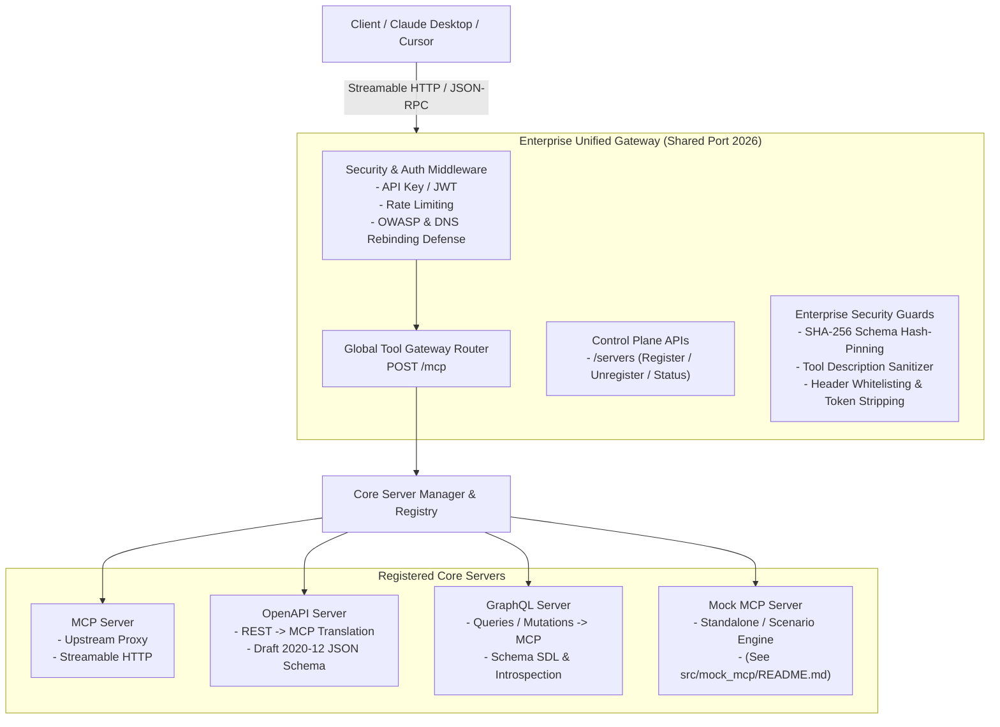

# Enterprise MCP Gateway

The **Enterprise Unified MCP Gateway** is built on **Python 3.14**, supporting **Dynamic Registration of MCP Servers, OpenAPI Servers, and GraphQL Servers**, featuring a **Global Tool Gateway Router (`POST /mcp`)**, fully compliant with the **MCP Specification (2026-07-28)** and **JSON Schema Draft 2020-12**.

---

## 🏛️ System Architecture Diagram



---

## 🐍 Environment & Runtime Requirements

- **Python Version**: `3.14` (Configured via `.python-version`, `pyproject.toml`, `Dockerfile`, and `uv.lock`).
- **Package Manager**: `uv` (Fast Python package installer).
- **Core Frameworks**: `starlette`, `pydantic>=2.10.0`, `loguru>=0.7.3`, `pyjwt>=2.10.0`, `httpx>=0.28.0`.

---

## 🌐 Dynamic Server Control Plane (`/servers`)

All external upstream connections (**MCP Servers**, **OpenAPI Servers**, and **GraphQL Servers**) are centrally and uniformly managed under a **SINGLE resource endpoint collection (`/servers`)**:

1. **Server Lifecycle & Management APIs**:
   - `POST /servers/register`: Dynamically register an **MCP Server**, **OpenAPI Server**, or **GraphQL Server**.
   - `GET /servers`: List all registered servers.
   - `GET /servers/{server_id}`: Retrieve detailed configuration of a specific server.
   - `GET /servers/{server_id}/status`: Check runtime health status (`Running`, `Paused`, `Stopped`, `Failed`).
   - `GET /servers/{server_id}/logs`: Inspect runtime Loguru logs for the server.
   - `GET /servers/{server_id}/tools`: List discovered MCP tools from the server.
   - `PUT /servers/{server_id}`: Update configuration or Pause/Resume the server.
   - `DELETE /servers/{server_id}`: Unregister/remove the server from the gateway.

2. **Enterprise Security Guards**:
   - **SHA-256 Schema Hash-Pinning Guard**: Prevents rug-pull attacks involving unauthorized dynamic schema alterations.
   - **Tool Description Sanitizer**: Strips malicious prompt injection vectors from tool descriptions.
   - **Header Forwarding Whitelist & Token Stripping**: Automatically strips incoming client `Authorization: Bearer` tokens before forwarding downstream, while supporting header whitelisting (`allowed_forward_headers`) and transparent propagation of standard telemetry headers (`X-Request-ID`, `traceparent`, `X-Session-ID`, `X-MCP-Scenario`).

---

## 🌐 Global Tool Gateway Router (`POST /mcp`)

The centralized **`POST /mcp`** endpoint operates on a single shared port (`2026`) conforming to the MCP 2026-07-28 specification:
- **Auto-Aggregation**: Consolidates tool catalogs from all running servers.
- **Dynamic Routing**: Intelligently routes `tools/call` invocations to the correct **MCP Server**, **OpenAPI Server**, or **GraphQL Server**.
- **Security Enforcement**: Applies Authentication (API Key / JWT), Sliding-Window Rate Limiting, and Header Whitelisting.

---

## 🔌 Supported Server Types (MCP, OpenAPI, GraphQL)

The system natively supports three core server types:
- **MCP Server**: Connects to native MCP servers via Streamable HTTP/JSON-RPC.
- **OpenAPI Server**: Parses OpenAPI specifications (v3.x) from URLs or local paths, dereferences `$ref` pointers, and translates REST endpoints (`GET`, `POST`, `PUT`, `DELETE`) into MCP tools adhering strictly to JSON Schema Draft 2020-12.
- **GraphQL Server**: Parses GraphQL schemas (SDL or introspection queries) and converts Queries and Mutations into MCP tools with robust type casting and automated selection set generation.

---

## 🌐 Control Plane Endpoints

| Endpoint | Method | Description |
| :--- | :--- | :--- |
| `/` | `GET` | Gateway homepage & health status |
| `/mcp` | `POST` | **Global Tool Gateway Router** (Centralized JSON-RPC routing) |
| `/servers` | `GET` | List all registered servers |
| `/servers/register` | `POST` | Dynamically register an MCP Server, OpenAPI Server, or GraphQL Server |
| `/servers/{server_id}` | `GET` / `PUT` / `DELETE` | View details, update (Running/Paused), or unregister a server |
| `/servers/{server_id}/status` | `GET` | View detailed runtime health status |
| `/servers/{server_id}/logs` | `GET` | View runtime loguru logs |
| `/servers/{server_id}/tools` | `GET` | List discovered MCP tools |
| `/metrics` | `GET` | Export Prometheus telemetry metrics |

---

## ⚡ Makefile Commands

| Command | Description |
| :--- | :--- |
| `make install` | Install Python dependencies using `uv` |
| `make test` | Run the automated pytest test suite |
| `make run` / `make run-gateway` | Run the Enterprise Unified Gateway (Port 2026) |
| `make run-mock` | Run the Standalone Mock MCP Service (Port 2027) |
| `make up` | Start Docker Compose (`mcp-gateway` & `mock-mcp`) in the background |

---

## 🤖 Client Integration (Claude Desktop / Cursor)

Configure `claude_desktop_config.json`:

```json
{
  "mcpServers": {
    "enterprise-mcp-gateway": {
      "url": "http://localhost:2026/mcp"
    }
  }
}
```

---

## 📖 Deep-Dive Architecture Documentation

Detailed technical documentation covering low-level algorithms—such as OpenAPI/GraphQL translation, ASGI stream starvation defense via `replayed_receive`, scenario isolation via `ContextVar`, and JWT/Rate Limiting security infrastructure—is maintained in the architecture ledger:
👉 **[`AGENTS.md`](AGENTS.md)**

---

## 📖 Mock MCP Service Documentation (`mock_mcp`)

For comprehensive details on **`mock_mcp`** (Scenario Engine, Chaos Fault Injection, Trace Recording, Fixtures, Meta-Tools), refer to:
👉 **[`src/mock_mcp/README.md`](src/mock_mcp/README.md)**
