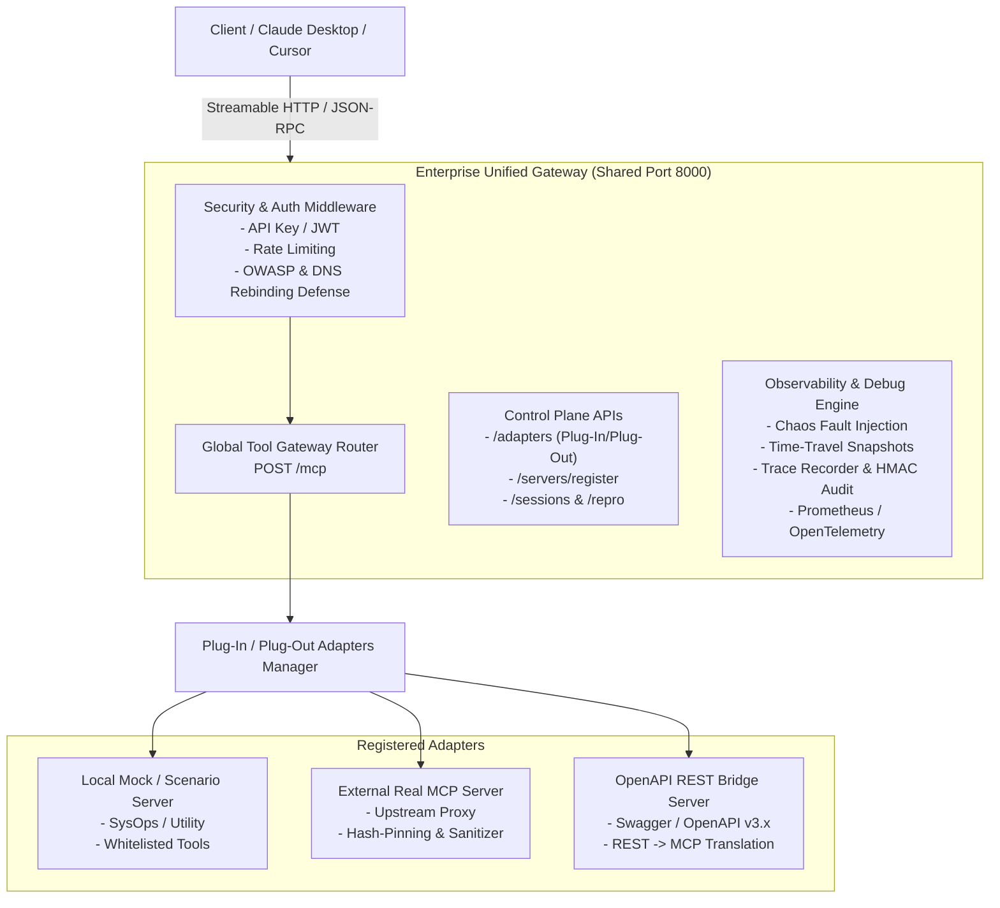

# Enterprise Mock MCP Gateway & Real-World Bug Reproduction Engine

Hệ thống **Enterprise Dynamic Scenario MCP Gateway** phát triển trên **Python 3.14**, hỗ trợ **Kiến trúc Plug-In / Plug-Out Adapter linh hoạt**, **Global Tool Gateway Router (`POST /mcp`)**, và **Đăng ký Dynamic & Proxy các MCP Servers Thật bên ngoài qua Streamable HTTP** (chuẩn hóa 100% HTTP, loại bỏ hoàn toàn STDIO) tích hợp công cụ **Chẩn Đoán & Tái Hiện Bug Thực Tế (Real-World Debug & Deterministic Reproduction Engine)**.

---

## 🏛️ Sơ Đồ Kiến Trúc Hệ Thống (Architecture Diagram)



---

## 🐍 Yêu Cầu Môi Trường & Chuẩn Hóa Runtime

- **Python Version**: `3.14` (Cấu hình chuẩn hóa qua `.python-version`, `pyproject.toml` (`requires-python = ">=3.14"`), `Dockerfile` (`python:3.14-slim`), và `uv.lock`).
- **Package Manager**: `uv` (Fast Python package installer).
- **Core Frameworks**: `fastmcp>=3.4.4`, `pydantic>=2.10.0`, `starlette`, `loguru>=0.7.3`, `pyjwt>=2.10.0`, `httpx>=0.28.0`.

---

## 🔌 Kiến Trúc Plug-In / Plug-Out Adapters (`adapters.py`)

Hệ thống coi mọi MCP Server—dù là **Local Mock Server**, **Dynamic Scenario Mock**, hay **External Real Upstream MCP Server**—đều là các **PlugInAdapters** thống nhất dưới Control Plane API (`/adapters`):

1. **Plug-In Lifecycle APIs**:
   - `POST /adapters`: Cắm vào (Plug-in) và kích hoạt một MCP Server Adapter mới.
   - `GET /adapters`: Liệt kê tất cả Adapters đang cắm trong hệ thống.
   - `GET /adapters/{name}`: Lấy thông tin metadata của Adapter.
   - `GET /adapters/{name}/status`: Kiểm tra trạng thái vận hành (`Running`, `Paused`, `Stopped`, `Failed`).
   - `GET /adapters/{name}/logs`: Xem nhật ký runtime loguru dành riêng cho từng Adapter.
   - `PUT /adapters/{name}`: Cập nhật cấu hình hoặc Tạm dừng (Pause) / Kích hoạt lại (Resume).
   - `DELETE /adapters/{name}`: Rút ra (Plug-out / Unregister) Adapter khỏi Gateway.

2. **Bảo toàn các Tính Năng Mock Chuyên Biệt Hệ Thống (System-Wide Mock Features)**:
   Mọi Adapter khi cắm vào Gateway (kể cả MCP Server thật ngoài hệ thống) **đều tự động được bao bọc và hỗ trợ đầy đủ các tính năng mock chuyên biệt**:
   - **Chaos Fault Injection**: Bơm lỗi độ trễ `latency`, HTTP 429/502/503/504, lỗi ngẫu nhiên, payload biến dạng.
   - **Time-Travel Snapshots**: Chụp checkpoint và du hành khôi phục trạng thái.
   - **Trace Recording & Repro Bundle**: Tự động ghi vết trace và xuất gói `.mcp-repro.json` để replay.
   - **Security Guards**: SHA-256 Schema Hash-Pinning, Tool Description Sanitizer, Per-Call Authorization.

## 🎯 Tính Năng Lọc Theo Các MCP Cụ Thể (Specific MCP Filtering)

Hệ thống hỗ trợ lọc và định tuyến yêu cầu theo các MCP server / adapter cụ thể trên cả Data Plane (`POST /mcp`), Control Plane (`/adapters/{name}/tools`), và Meta-Tools (`find_tools`):

1. **Lọc Danh Sách Công Cụ (`tools/list` & `GET /adapters/{name}/tools`)**:
   - **JSON-RPC (`POST /mcp`)**: Truyền tham số `params: {"servers": ["utility-scenario"]}` hoặc query string `?mcp=utility-scenario,sysops-scenario` để chỉ lấy danh sách công cụ từ các MCP server được chỉ định.
   - **REST API**: Gọi `GET /adapters/{name}/tools` để xem toàn bộ công cụ của riêng một adapter/server cụ thể.
2. **Điều Tuyến Trực Tiếp (`tools/call`)**:
   - Khi gọi công cụ qua `POST /mcp`, client có thể chỉ định rõ adapter xử lý bằng tham số `params: {"name": "...", "server": "utility-scenario"}` (hoặc `adapter` / `mcp`). Gateway sẽ định tuyến trực tiếp tới adapter đó thay vì quét toàn bộ hệ thống.
3. **Lọc Tìm Kiếm Thông Minh (`find_tools`)**:
   - Meta-tool `find_tools(query, top_k=3, mcp_filter=["utility-scenario"])` cho phép giới hạn phạm vi tìm kiếm ngữ nghĩa chỉ trong các MCP server cụ thể.

---

Endpoint tập trung **`POST /mcp`** hoạt động như một Intelligent Router:
- **Tự động hợp nhất (Aggregate)** danh mục công cụ từ tất cả các Plug-In Adapters đang chạy (`Running`).
- **Tự động điều tuyến (Dynamic Routing)** các cuộc gọi `tools/call` tới đúng Adapter chịu trách nhiệm xử lý (Mock Local hoặc External Real Server over HTTP).
- **Thi hành An ninh & Ghi vết**: Áp dụng Per-Call Auth, Chaos Engine, và Trace Recording xuyên suốt toàn bộ luồng điều tuyến tập trung.

---

## 🌐 Đăng Ký MCP Server Thật & Upstream Proxy Routing (`proxy.py` & `openapi_bridge.py`)

Hệ thống loại bỏ hoàn toàn giao thức STDIO để chuẩn hóa **100% trên giao thức Streamable HTTP / HTTP JSON-RPC** và **OpenAPI REST Specifications**. Cho phép kết nối và điều tuyến tới các **Real External MCP Servers** và các **OpenAPI REST Servers**:

1. **Dynamic Registration API (`POST /servers/register`)**: Đăng ký các server MCP thật (`server_type="mcp"`) hoặc REST API Servers dựa trên OpenAPI spec (`server_type="openapi"`).
2. **Upstream & OpenAPI Tool Auto-Discovery & Security Enforcer**: Tự động lấy danh sách công cụ từ server thật qua JSON-RPC `tools/list` hoặc tự động phân tích cú pháp tệp `openapi.json/yaml` để chuyển đổi các endpoint REST (`GET`, `POST`, `PUT`, `DELETE`) thành các MCP tools, áp dụng ngay SHA-256 Hash-Pinning và Description Sanitizer.
3. **Transparent Request Forwarding (`forward_tool_call` & `call_openapi_tool`)**: Chuyển tiếp minh bạch các yêu cầu `tools/call` đến server MCP thật hoặc biến đổi các tham số (path, query, body) và gửi request HTTP REST đến dịch vụ OpenAPI tương ứng, kết hợp ghi vết Trace và Prometheus metrics.

---

## 🐞 Tính Năng Chẩn Đoán & Tái Hiện Bug Thực Tế (Real-World Debug Engine)

1. **Deterministic Execution Trace Recording (`recorder.py`)**: Ghi vết thời gian thực mọi bước gọi công cụ JSON-RPC, tham số đầu vào, kết quả trả về, độ trễ `duration_ms`, và mã băm SHA-256 biến đổi trạng thái trước/sau từng bước.
2. **Chaos & Real-World Fault Injection Engine (`chaos.py`)**: Giả lập các sự cố hạ tầng thực tế:
   - `latency`, `error_rate`, `http_status` (429/502/503/504), `malformed_json`, `schema_drift`.
3. **Time-Travel State Snapshots (`session.py`)**: Chụp ảnh nhanh trạng thái (`create_snapshot`), khôi phục trạng thái (`restore_snapshot`), và so sánh chênh lệch (`diff_snapshots`).
4. **Self-Contained Repro Bundle (`.mcp-repro.json`)**: Xuất toàn bộ kịch bản lỗi thành tệp gói gọn `.mcp-repro.json`.
5. **Deterministic Replay & Drift Analysis Engine (`ReplayEngine`)**: Tái chạy lại chính xác vết cuộc gọi cũ step-by-step để phát hiện sai lệch dữ liệu.

---

## 🌐 Control Plane & Management Endpoints

| Endpoint | Method | Mô tả |
| :--- | :--- | :--- |
| `/adapters` | `GET` | **Liệt kê tất cả Plug-In MCP Adapters** (Mock & Real Servers) |
| `/adapters` | `POST` | **Cắm vào (Plug-in) và kích hoạt một Adapter mới** |
| `/adapters/{name}` | `GET` | Lấy chi tiết cấu hình metadata của Adapter |
| `/adapters/{name}/status` | `GET` | **Lấy trạng thái vận hành thực tế** (`Running`, `Paused`, `Stopped`) |
| `/adapters/{name}/logs` | `GET` | **Truy vấn nhật ký runtime loguru của riêng Adapter** |
| `/adapters/{name}` | `PUT` | Cập nhật cấu hình hoặc Tạm dừng / Kích hoạt lại Adapter |
| `/adapters/{name}` | `DELETE` | **Rút ra (Plug-out / Unregister) Adapter khỏi Gateway** |
| `/mcp` | `POST` | **Global Tool Gateway Router** (Điều tuyến JSON-RPC tập trung) |
| `/servers/register` | `POST` | Đăng ký động MCP Server thật ngoài hệ thống |
| `/sessions/{session_id}/trace` | `GET` | Xem toàn bộ lịch sử trace cuộc gọi tool và thay đổi trạng thái |
| `/sessions/{session_id}/repro` | `GET` | Tải về gói tái hiện bug tự chứa (`.mcp-repro.json`) |
| `/repro/replay` | `POST` | Import và phát lại kịch bản bug đính kèm phân tích Drift |
| `/scenarios/{scenario_id}/chaos` | `POST` / `DELETE` | Cấu hình / Xóa quy tắc bơm lỗi Chaos Injection |
| `/metrics` | `GET` | Xuất chỉ số đo lường Prometheus |

---

## ⚡ Các Lệnh Makefile

| Lệnh | Mô tả |
| :--- | :--- |
| `make install` | Cài đặt các thư viện phụ thuộc bằng `uv` với Python 3.14 |
| `make test` | Chạy bộ kiểm thử tự động pytest trên Python 3.14 |
| `make run` / `make run-gateway` | Chạy Enterprise Unified Gateway (Cổng chung 8000 duy nhất, không expose port riêng cho từng mock) |
| `make up` | Khởi chạy Docker Compose Gateway ở background |

---

## 🤖 Tích Hợp Claude Desktop / Cursor & CI/CD Regression Replay Pipelines

### 1. Tích Hợp Claude Desktop / Cursor (`claude_desktop_config.json`)
Để kết nối Claude Desktop hoặc Cursor tới Enterprise Dynamic Scenario MCP Gateway qua chuẩn Streamable HTTP, cấu hình tệp `claude_desktop_config.json` của bạn như sau:

```json
{
  "mcpServers": {
    "enterprise-mcp-gateway": {
      "url": "http://localhost:8000/mcp"
    }
  }
}
```

### 2. CI/CD Automated Regression Replay Pipelines
Mỗi khi xảy ra lỗi trong quá trình sản xuất hoặc kiểm thử AI agents, hệ thống tự động sinh ra gói `.mcp-repro.json`. Bạn có thể tích hợp kiểm thử hồi quy tự động trong GitHub Actions:

```yaml
name: MCP Gateway Regression Replay
on: [push, pull_request]
jobs:
  replay-tests:
    runs-on: ubuntu-latest
    steps:
      - uses: actions/checkout@v4
      - name: Set up Python 3.14 & uv
        uses: astral-sh/setup-uv@v5
        with:
          python-version: "3.14"
      - name: Install dependencies
        run: uv sync
      - name: Run Pytest Regression Suite
        run: uv run pytest tests/test_mcp_real_world_debugging.py
```

### 3. Containerized Deployment (Docker & Docker Compose)
- **Build Image**: `docker build -t enterprise-mcp-gateway:latest .`
- **Run Compose**: `docker compose up -d` (Khởi chạy Gateway kèm Prometheus/Grafana metrics monitoring).

