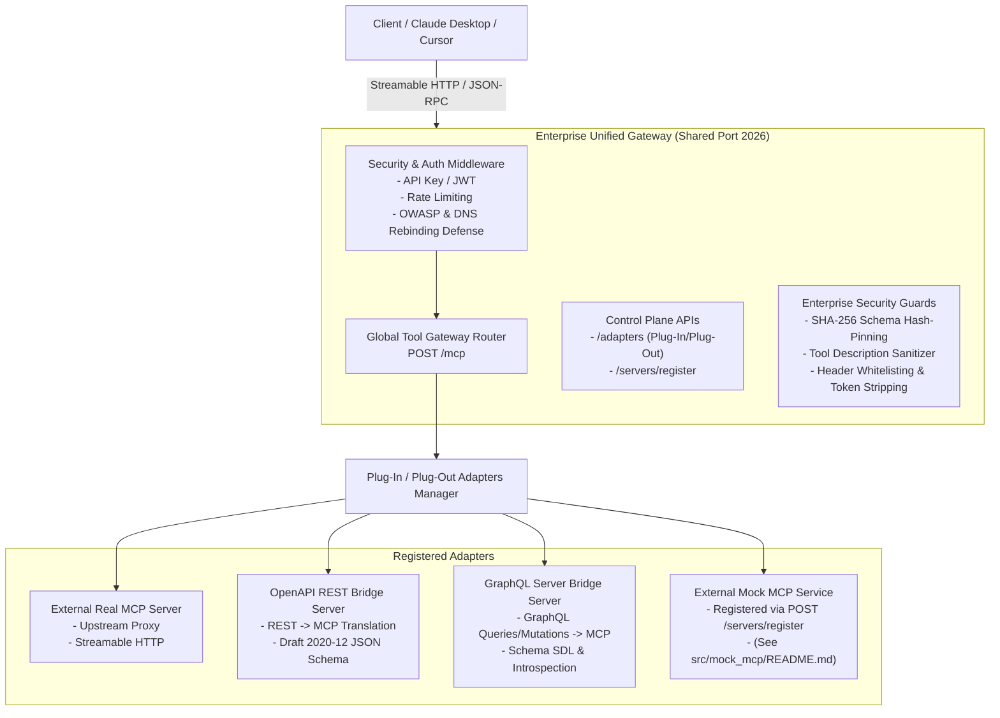

# Enterprise MCP Gateway & OpenAPI REST Server Bridge

Hệ thống **Enterprise Unified MCP Gateway** phát triển trên **Python 3.14**, hỗ trợ **Kiến trúc Plug-In / Plug-Out Adapter linh hoạt**, **Global Tool Gateway Router (`POST /mcp`)**, **Đăng ký Dynamic & Upstream Proxy MCP Servers qua Streamable HTTP**, **OpenAPI REST Bridge Adapter (`OPENAPI_BRIDGE`)**, và **GraphQL Server Bridge Adapter (`GRAPHQL_BRIDGE`)** compliant với **MCP Specification (2026-07-28)** và **JSON Schema Draft 2020-12**.

---

## 🏛️ Sơ Đồ Kiến Trúc Hệ Thống (Architecture Diagram)



---

## 🐍 Yêu Cầu Môi Trường & Runtime

- **Python Version**: `3.14` (Cấu hình qua `.python-version`, `pyproject.toml`, `Dockerfile`, và `uv.lock`).
- **Package Manager**: `uv` (Fast Python package installer).
- **Core Frameworks**: `starlette`, `pydantic>=2.10.0`, `loguru>=0.7.3`, `pyjwt>=2.10.0`, `httpx>=0.28.0`.

---

## 🔌 Kiến Trúc Plug-In / Plug-Out Adapters (`mcp_gateway/core/adapters.py`)

Hệ thống quản lý mọi MCP Server (dù là External Real Upstream MCP Server, OpenAPI REST Server, hay Standalone Mock Server) dưới dạng các **PlugInAdapters** trên Control Plane (`/adapters`):

1. **Plug-In Lifecycle APIs**:
   - `POST /adapters`: Cắm vào (Plug-in) và kích hoạt một Adapter mới.
   - `GET /adapters`: Liệt kê tất cả Adapters đang cắm trong hệ thống.
   - `GET /adapters/{name}`: Lấy thông tin metadata của Adapter.
   - `GET /adapters/{name}/status`: Kiểm tra trạng thái vận hành (`Running`, `Paused`, `Stopped`, `Failed`).
   - `GET /adapters/{name}/logs`: Xem nhật ký runtime loguru của từng Adapter.
   - `PUT /adapters/{name}`: Cập nhật cấu hình hoặc Tạm dừng / Kích hoạt lại.
   - `DELETE /adapters/{name}`: Rút ra (Plug-out / Unregister) Adapter khỏi Gateway.

2. **Bảo vệ An Ninh Enterprise (Security Guards)**:
   - **SHA-256 Schema Hash-Pinning Guard**: Phòng chống tấn công Rug-Pull sửa đổi schema động.
   - **Tool Description Sanitizer**: Loại bỏ mã độc/prompt injection trong mô tả công cụ.
   - **Header Forwarding Whitelist & Token Stripping**: Tự động loại bỏ `Authorization: Bearer` của client trước khi chuyển tiếp downstream, đồng thời hỗ trợ `allowed_forward_headers` whitelist và truyền minh bạch các header chuẩn (`X-Request-ID`, `traceparent`, `X-Session-ID`, `X-MCP-Scenario`).

---

## 🌐 Global Tool Gateway Router (`POST /mcp`)

Endpoint tập trung **`POST /mcp`** hoạt động trên một cổng duy nhất (`2026`) theo chuẩn MCP 2026-07-28 Spec:
- **Tự động hợp nhất (Aggregate)** danh mục công cụ từ tất cả các Adapters đang chạy (`Running`).
- **Tự động điều tuyến (Dynamic Routing)** các cuộc gọi `tools/call` tới đúng Upstream MCP Server hoặc OpenAPI Bridge.
- **Thi hành An ninh**: Áp dụng Authentication (API Key / JWT), Sliding-Window Rate Limiting, và Header Whitelisting.

---

## 🌉 OpenAPI REST & GraphQL Server Bridge Adapters (`OPENAPI_BRIDGE` & `GRAPHQL_BRIDGE`)

Hệ thống tự động chuyển đổi các REST API Servers (OpenAPI v3.x) và GraphQL Servers (SDL hoặc Introspection) thành các MCP Tools tuân thủ chuẩn JSON Schema Draft 2020-12:
- **OpenAPI Bridge**: Phân tích cú pháp OpenAPI Spec từ URL/local path, dereference `$ref` và chuyển đổi REST endpoints (`GET`, `POST`, `PUT`, `DELETE`) thành MCP tools.
- **GraphQL Bridge**: Phân tích cú pháp GraphQL Schema (SDL hoặc introspection query) và dịch các Queries và Mutations thành các MCP tools với kiểu dữ liệu chuẩn và tự động sinh selection sets.

---

## 🌐 Control Plane Endpoints

| Endpoint | Method | Mô tả |
| :--- | :--- | :--- |
| `/` | `GET` | Trang chủ & thông tin trạng thái Gateway |
| `/mcp` | `POST` | **Global Tool Gateway Router** (Điều tuyến JSON-RPC tập trung) |
| `/adapters` | `GET` | Liệt kê tất cả Plug-In Adapters |
| `/adapters` | `POST` | Kích hoạt/Cắm vào một Adapter mới |
| `/adapters/{name}` | `GET` / `PUT` / `DELETE` | Xem chi tiết, cập nhật, hoặc tháo gỡ Adapter |
| `/servers/register` | `POST` | Đăng ký động Upstream MCP Server hoặc OpenAPI Bridge Server |
| `/servers` | `GET` | Liệt kê danh sách các server đã đăng ký |
| `/servers/{server_id}` | `DELETE` | Hủy đăng ký một server |
| `/metrics` | `GET` | Xuất chỉ số đo lường Prometheus |

---

## ⚡ Các Lệnh Makefile

| Lệnh | Mô tả |
| :--- | :--- |
| `make install` | Cài đặt các thư viện phụ thuộc bằng `uv` |
| `make test` | Chạy bộ kiểm thử tự động pytest |
| `make run` / `make run-gateway` | Chạy Enterprise Unified Gateway (Port 2026) |
| `make run-mock` | Chạy Standalone Mock MCP Service (Port 2027) |
| `make up` | Khởi chạy Docker Compose (`mcp-gateway` & `mock-mcp`) ở background |

---

## 🤖 Tích Hợp Client (Claude Desktop / Cursor)

Cấu hình `claude_desktop_config.json`:

```json
{
  "mcpServers": {
    "enterprise-mcp-gateway": {
      "url": "http://localhost:2026/mcp"
    }
  }
}
```

---

## 📖 Tài Liệu Cho Dịch Vụ Mock MCP (`mock_mcp`)

Xem tài liệu đầy đủ về **`mock_mcp`** (Scenario Engine, Chaos Fault Injection, Time-Travel Snapshots, Trace Recording, Fixtures, Meta-Tools) tại:
👉 **[`src/mock_mcp/README.md`](src/mock_mcp/README.md)**
